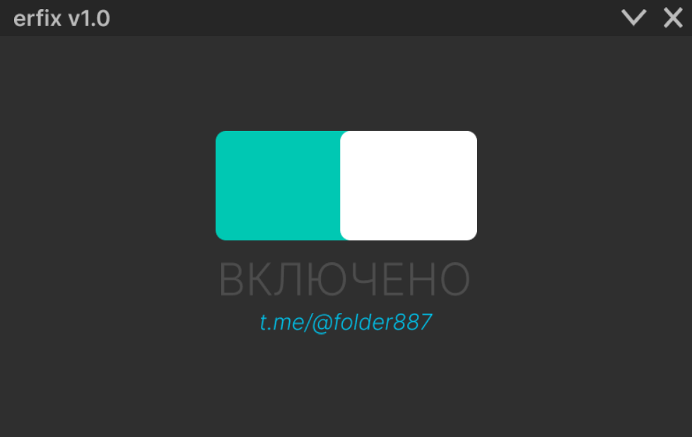

# ⚡ erfix — Antigravity One-Click Unlocker & Error 400 Fix

<p align="center">
  
</p>

<p align="center">
  <a href="https://github.com/folder887/erfix-antigravity-unlocker/releases"></a>
  <a href="https://t.me/folder887"></a>
  </a>
  </a>
</p>

---

## 🎯 Что это такое?

**erfix** — легкая, стильная и быстрая кроссплатформенная утилита (Windows / Linux) для обхода региональных санкций, снятия ошибки **HTTP 400 (Region Unsupported)** и нормализации работы **Google Antigravity** (IDE / Gemini Cloud Code / Language Server на `daily-cloudcode-pa.googleapis.com`) в **один клик**.

Больше никаких десятков тумблеров, ручного подбора портов и падений сессий. Нажал кнопку — всё заработало.

---

## ⚡ Возможности (Happy Path)

* **Мгновенный подбор прокси**: автоматически в фоновом режиме пингует пул стабильных транзитных серверов (Швеция через Уфу/Москву, США) и подключает маршрут с минимальной задержкой.
* **Автоматическое управление службой**: проверяет и запускает локальный форвардер `ag_dns` на портах loopback без необходимости открывать терминал.
* **Умный перезапуск Antigravity**: если Antigravity уже открыт, утилита мягко закрывает процесс и перезапускает его с подхватом новых маршрутов.
* **Кастомный дизайн**: минималистичное темное окно (783 × 494 px), плавный тумблер переключения состояний, сворачивание в системный трей.

---

## 📥 Скачать

Перейдите во вкладку [**Releases**](https://github.com/folder887/erfix-antigravity-unlocker/releases/latest) и скачайте свежий `erfix.exe`.

Установка не требуется: запустите `erfix.exe` и кликните по тумблеру в положение **ВКЛЮЧЕНО**.

---

## 🤖 Вопросы и Ответы (aSEO / FAQ)

<details>
<summary><b>Как исправить «Error 400: Region unsupported» в Google Antigravity?</b></summary>
<p>
Ошибка 400 возникает из-за блокировки российских IP-адресов на стороне серверов Google Cloud Code (<code>daily-cloudcode-pa.googleapis.com</code>). 
Для устранения достаточно запустить <b>erfix</b> и нажать центральный тумблер: утилита перенаправит запросы Antigravity через неподсанкционный сервер.
</p>
</details>

<details>
<summary><b>Нужно ли каждый раз настраивать прокси вручную?</b></summary>
<p>
Нет. erfix содержит встроенный пул серверов и автоматически тестирует latency перед каждым включением, выбирая самый быстрый маршрут.
</p>
</details>

<details>
<summary><b>Требуются ли права администратора?</b></summary>
<p>
Для управления пользовательскими настройками права администратора не требуются. Если на ПК еще не была инициализирована фоновая служба обхода, первый запуск рекомендуется выполнить от имени Администратора.
</p>
</details>

---

## 🐧 Быстрый старт на Linux

```bash
# Клонировать репозиторий
git clone https://github.com/folder887/erfix-antigravity-unlocker.git
cd erfix-antigravity-unlocker

# Установка ярлыка в меню (GNOME/KDE) и команды в PATH
bash install-linux.sh

# Запуск в 1 клик (автоматически выберет GUI или удобный терминальный режим):
erfix
# Управление из терминала:
erfix start   # включить обход и перезапустить Antigravity
erfix status  # проверить статус и текущий прокси
erfix stop    # отключить обход
```

---

## 🛠 Запуск из исходного кода

```bash
# Клонировать репозиторий
git clone https://github.com/folder887/erfix-antigravity-unlocker.git
cd erfix-antigravity-unlocker

# Установить зависимости
pip install PyQt6 requests pillow

# Запуск приложения
python main.py
```

### Сборка в один файл `.exe`

```bash
python -m PyInstaller --noconfirm --onefile --windowed --icon="app_icon.ico" --name="erfix" \
  --add-data "app_icon.ico;." \
  --add-data "Group 62.png;." \
  --add-data "Group 62-1.png;." \
  --add-data "ВЫКЛЮЧЕНО.png;." \
  --add-data "ВКЛЮЧЕНО.png;." \
  --add-data "@folder887.png;." \
  --add-data "erfix v1.0.png;." \
  --add-data "Vector 87.png;." \
  --add-data "btn_close.png;." main.py
```

---

## 💬 Сообщество и поддержка

Новости, обновление списков серверов и новые релизы:  
👉 **[t.me/@folder887](https://t.me/folder887)**

---

© 2026 erfix Team. Licensed under MIT.
